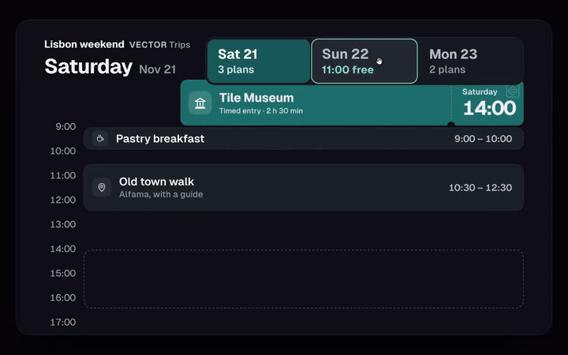

# Trip Plan

**Drop a plan on another day. The day slides in under it, and it lands in the first free slot.**



**Live demo:** [veraetogrex-portfolio.github.io/trip-plan](https://veraetogrex-portfolio.github.io/trip-plan/) · **Mockup:** [full-screen version](https://veraetogrex-portfolio.github.io/trip-plan/mockup/trip-plan.html)

A trip planner that shows one day at a time, hour by hour, with the days of the trip as chips on top. Pick up a plan and hold it over a chip: the chip tells you where it would fit ("11:00 free") or that the day is full. Let go and the new day slides in under the plan you are holding, its free window shows, and the plan drops into it. A booked entry is a ticket, and its stub turns over to the new day and time.

## Use it

Three files, no build step, no dependencies, no web fonts:

```
index.html   markup
style.css    styles
script.js    data, scheduling and animation
```

Download the repo and open `index.html`, or copy the three files into your project.

## Try it

- Drag the Tile Museum ticket (or any plan) onto Sun 22. While you hold it over the chip, the chip says "11:00 free"; drop it and it lands on Sunday at 11:00 with "Moved to Sunday".
- Hold a plan over a day with no room: the chip says "No free time" and the plan goes back when you drop it. Dropping it on its own day or anywhere else in the lane puts it back too, and so does Esc while dragging.
- Click Undo, or press Ctrl+Z / ⌘Z: the plan rides back to its old day and time.
- Click a day chip, or focus the chips and use ← →, to switch days.
- Tab to a plan and press ← → to move it to the previous or next day. If there is no room, it shakes and stays.
- With reduced motion turned on, every move jumps straight to the end.

## Make it yours

At the top of `script.js`:

- `DAYS`: the days of the trip (`name`, chip label `short`, `date`).
- `START`: the plans — `what`, `where`, `day` (index in `DAYS`), `start` hour, `hours`, an `ico` name, and `ticket: true` for a booked entry with a stub.
- `OPEN`, `CLOSE`: the hours the day shows (9:00–17:00); `HOUR`: pixels per hour.
- `BREAK`: the free time kept between plans when looking for a slot (half an hour).
- `DOCK`: how small a plan gets while it hangs under a day chip.
- `ICONS`: the line icons for plans.

Colours live in `:root` in `style.css`: `--ticket` for the booked ticket and the open day, `--sea` for the free slot and Undo, `--plan` for ordinary plans.

## What's in `mockup/`

The full 1440×900 screen this component was shot in for the reel:

- `mockup/trip-plan.html` — interactive. `D` plays the demo, `R` resets.
- `mockup/trip-plan.autoplay.html` — the scripted loop the reel was recorded from.
- URL flags: `?frame` puts the screen in a browser window, `?clean` hides the control panel, `?once` plays the demo once.

The mockup loads the same `style.css` and `script.js` from the root, plus a shared stage runtime and bundled fonts from `mockup/_shared/`. The component in the root doesn't need any of it.

---

Component 26 of a series. New one every day on Instagram [@veraetogrex_portfolio](https://www.instagram.com/veraetogrex_portfolio/) · all components: [github.com/veraetogrex-portfolio](https://github.com/veraetogrex-portfolio)

MIT licensed.
